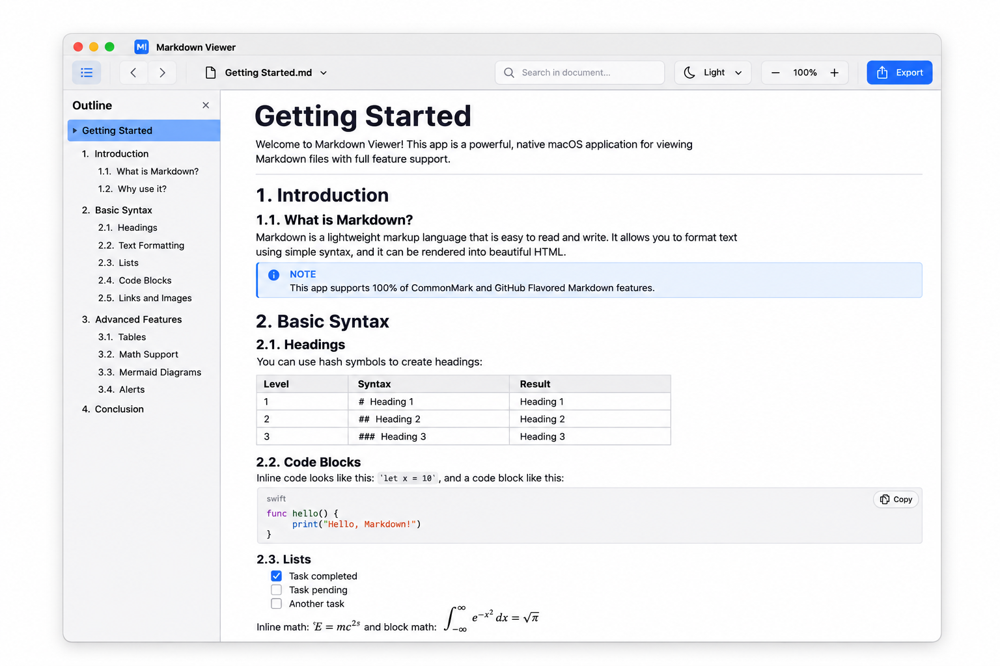
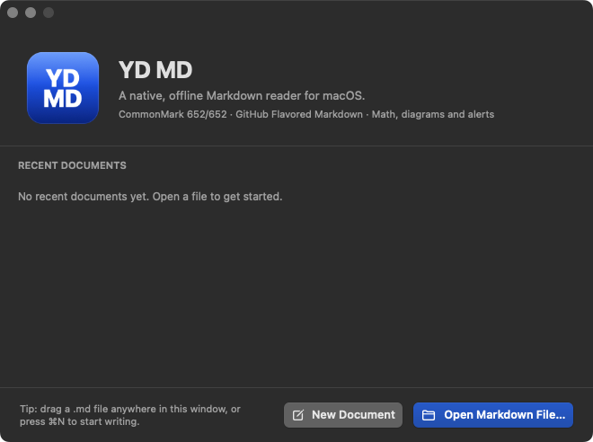
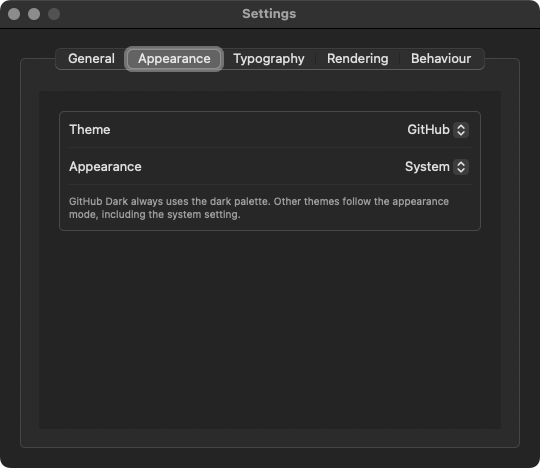
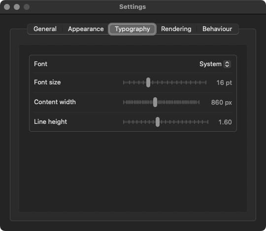
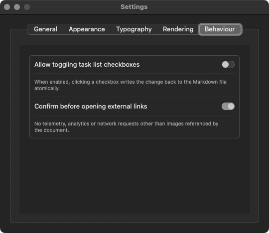
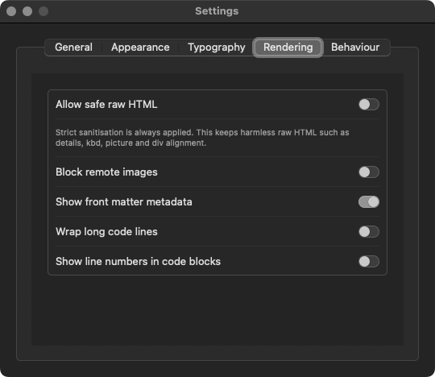

<p align="center">
  
</p>

<h1 align="center">YD MD</h1>

<p align="center"><strong>Best Markdown Apps for MacOS</strong></p>

<p align="center">A native, offline Markdown reader for macOS.<br>Open a file and it arrives as a finished document.</p>

<p align="center">
  <a href="https://github.com/YandiDesign/YD-MD/releases/latest/download/YD-MD-1.0.dmg">Download for macOS</a>
  &middot;
  <a href="https://yd-md.pages.dev">Website</a>
  &middot;
  <a href="https://github.com/YandiDesign/YD-MD/releases">Releases</a>
</p>

<p align="center">Version 1.0 &middot; 4.0 MB &middot; macOS 13 or later</p>

<p align="center"><a href="#english">English</a> | <a href="#bahasa-indonesia">Bahasa Indonesia</a></p>

<p align="center">
  
</p>

<p align="center"><em>Getting Started.md in the GitHub theme, with the outline open.</em></p>

## English

YD MD is a document reader for Markdown files on macOS. It treats a Markdown file the way a browser treats a page: headings, tables, code, math, diagrams and links all arrive as a finished document, not as plain text with a preview pane.

Every renderer is inside the app. YD MD makes no network request of its own, needs no account, and keeps no telemetry. It opens local files, renders them offline, and stays out of the way.

### Features

#### Complete Markdown rendering

- CommonMark 0.31.2 in full, with 652 of 652 spec examples passing.
- GitHub Flavored Markdown: tables with alignment, task lists, strikethrough, extended autolinks and the tag filter. 654 of 672 GFM tests pass, with 18 differences documented in the test report.
- Inline and block math with KaTeX.
- Mermaid diagrams: flowchart, sequence, class, state, ER, gantt, pie, git graph and mindmap.
- Fenced code with language labels, syntax highlighting and a Copy button.
- Footnotes, definition lists, abbreviations, subscript, superscript, highlight, insert and emoji shortcodes.
- GitHub alerts for Note, Tip, Important, Warning and Caution.
- Custom containers, table of contents markers and automatic heading anchors.
- YAML and TOML front matter, shown as a metadata table that can be hidden.
- Common HTML inside Markdown: details and summary, keyboard keys, images with size, picture, tables and centered blocks.
- Relative images resolved against the document folder, plus absolute paths, file URLs, data URIs and remote images.
- SVG, animated GIF, WebP and HEIC images.
- Automatic encoding detection for UTF-8, UTF-16 and Latin-1, including BOM and CRLF, LF or CR line endings.

#### A real reading window

- Native macOS document app with multiple windows and tabs, Open Recent, drag and drop, and Markdown document types registered for Finder.
- Outline sidebar with the full heading tree, click to jump, and the active heading tracked while you scroll.
- Search inside the document: every match counted, next and previous, case sensitive toggle, and keyboard shortcuts.
- Live reload when the file changes, with the scroll position kept. Atomic saves, renames and deletes are handled.
- Source view toggle with line numbers and syntax colouring.
- Zoom with the keyboard, the toolbar or a trackpad pinch.
- Code block copy, wrap toggle and optional line numbers.
- Task list checkboxes are read only by default. An explicit setting lets a click write that one change back to the file atomically.

#### Appearance that follows your reading

- Four themes: GitHub, GitHub Dark, Sepia and High Contrast.
- Each theme can follow the system appearance or stay fixed.
- Font, font size, content width and line height are sliders, saved between documents.
- The interface is available in English and Bahasa Indonesia.
- VoiceOver labels, full keyboard navigation, visible focus and contrast checked against WCAG AA.

#### Export and print

- PDF export with clean pagination and code blocks that stay intact.
- Standalone HTML export with inlined CSS and optional embedded images.
- Print with a stylesheet made for paper.

#### Private and safe by design

- The app runs sandboxed with the hardened runtime.
- Documents open read only.
- Raw HTML is sanitized. Scripts, event handlers and javascript URLs are blocked.
- One setting can block every remote image, so not a single byte leaves the Mac.
- No telemetry, no analytics, no account and no background network calls.

#### Built for large files

- Files of 5 MB and 100,000 lines stay responsive through incremental rendering and lazy math and diagram rendering.
- Live reload is debounced so a running editor does not restart the page on every keystroke.

### Screenshots

<p align="center">
  
</p>

<p align="center"><em>The welcome window. Recent documents, New Document and Open Markdown File.</em></p>

| Appearance | Typography |
| --- | --- |
|  |  |
| Theme and appearance | Font, size, width and line height |

| Behaviour | Rendering |
| --- | --- |
|  |  |
| Task toggling and link confirmation | Safe HTML, remote images, front matter and code options |

### Requirements

- macOS 13 Ventura or later.
- The 1.0 build is Intel, x86_64. On Apple silicon it runs with Rosetta 2.
- No internet connection is needed after the download.

### Install

1. Download `YD-MD-1.0.dmg` from the [latest release](https://github.com/YandiDesign/YD-MD/releases/latest).
2. Open the disk image and drag **YD MD** to the Applications folder.
3. Open YD MD from Applications.
4. On first launch macOS may warn about an unidentified developer. The 1.0 build is signed ad hoc and is not notarized. Right click the app, choose **Open**, then choose **Open** again. macOS remembers the choice.

To make YD MD the default Markdown app, select a `.md` file in Finder, choose **Get Info**, then **Open with** and **Change All**.

### Verify the download

SHA-256 for `YD-MD-1.0.dmg`:

```
d69d65d198210f7c0d40a0866183e90d8ef6d23d6fb12e9babe5e1f78a0df9c6
```

Check it in Terminal with:

```bash
shasum -a 256 ~/Downloads/YD-MD-1.0.dmg
```

### Project

- Website: https://yd-md.pages.dev
- Public repository: source of the release build, this README and the issue tracker.
- Source code: kept in a private repository.
- Made by Yandi Design. Copyright 2026 YANDI DESIGN. All rights reserved.

If you find a bug, open an issue with the macOS version, the file that caused it and the steps to reproduce.

---

## Bahasa Indonesia

YD MD adalah pembaca dokumen Markdown untuk macOS. File Markdown diperlakukan seperti sebuah halaman di browser: heading, tabel, kode, matematika, diagram dan tautan tampil sebagai dokumen jadi, bukan teks polos dengan panel pratinjau.

Semua renderer berada di dalam aplikasi. YD MD tidak membuat permintaan jaringan sendiri, tidak memerlukan akun dan tidak mengirim telemetri. Aplikasi membuka file lokal, merendernya secara offline, lalu diam.

### Fitur

#### Rendering Markdown lengkap

- CommonMark 0.31.2 secara penuh, dengan 652 dari 652 contoh spec lulus.
- GitHub Flavored Markdown: tabel dengan perataan, task list, strikethrough, autolink dan tag filter. 654 dari 672 tes GFM lulus, dengan 18 perbedaan yang didokumentasikan di laporan tes.
- Matematika inline dan block dengan KaTeX.
- Diagram Mermaid: flowchart, sequence, class, state, ER, gantt, pie, git graph dan mindmap.
- Blok kode dengan label bahasa, syntax highlighting dan tombol Copy.
- Footnote, definition list, abbreviation, subscript, superscript, highlight, insert dan emoji shortcode.
- GitHub alerts untuk Note, Tip, Important, Warning dan Caution.
- Custom container, penanda table of contents dan anchor heading otomatis.
- Front matter YAML dan TOML, ditampilkan sebagai tabel metadata yang bisa disembunyikan.
- HTML umum di dalam Markdown: details dan summary, tombol keyboard, gambar dengan ukuran, picture, tabel dan blok rata tengah.
- Gambar relatif diselesaikan terhadap folder dokumen, ditambah path absolut, file URL, data URI dan gambar online.
- Gambar SVG, GIF animasi, WebP dan HEIC.
- Deteksi encoding otomatis untuk UTF-8, UTF-16 dan Latin-1, termasuk BOM serta akhir baris CRLF, LF atau CR.

#### Jendela baca yang sesungguhnya

- Aplikasi dokumen native macOS dengan banyak jendela dan tab, Open Recent, drag and drop, dan tipe dokumen Markdown terdaftar di Finder.
- Sidebar outline dengan seluruh pohon heading, klik untuk melompat, dan heading aktif mengikuti posisi scroll.
- Pencarian di dalam dokumen: semua hasil dihitung, next dan previous, toggle case sensitive, serta pintasan keyboard.
- Live reload saat file berubah, dengan posisi scroll dipertahankan. Atomic save, rename dan hapus file ditangani.
- Toggle source view dengan nomor baris dan pewarnaan sintaks.
- Zoom lewat keyboard, toolbar atau pinch trackpad.
- Copy pada blok kode, toggle wrap dan nomor baris opsional.
- Checkbox task list bersifat read only secara default. Satu pengaturan eksplisit memungkinkan klik menulis perubahan itu kembali ke file secara atomik.

#### Tampilan sesuai cara Anda membaca

- Empat tema: GitHub, GitHub Dark, Sepia dan High Contrast.
- Setiap tema bisa mengikuti tampilan sistem atau tetap pada satu pilihan.
- Font, ukuran font, lebar konten dan line height berupa slider, tersimpan antar dokumen.
- Antarmuka tersedia dalam Bahasa Inggris dan Bahasa Indonesia.
- Label VoiceOver, navigasi keyboard penuh, focus yang terlihat dan kontras yang diperiksa terhadap WCAG AA.

#### Export dan cetak

- Export PDF dengan pagination rapi dan blok kode yang tidak terpotong.
- Export HTML mandiri dengan CSS inline dan opsi menyematkan gambar.
- Cetak dengan stylesheet khusus kertas.

#### Privat dan aman sejak awal

- Aplikasi berjalan di dalam sandbox dengan hardened runtime.
- Dokumen dibuka read only.
- Raw HTML disanitasi. Script, event handler dan URL javascript diblokir.
- Satu pengaturan dapat memblokir semua gambar online, sehingga tidak ada satu byte pun yang keluar dari Mac.
- Tanpa telemetri, tanpa analytics, tanpa akun dan tanpa panggilan jaringan di latar belakang.

#### Siap untuk file besar

- File 5 MB dan 100.000 baris tetap responsif lewat rendering bertahap serta pemuatan matematika dan diagram secara lazy.
- Live reload diberi debounce agar editor yang sedang berjalan tidak memuat ulang halaman pada setiap ketikan.

### Tangkapan layar

<p align="center">
  
</p>

<p align="center"><em>Jendela selamat datang. Recent documents, New Document dan Open Markdown File.</em></p>

| Appearance | Typography |
| --- | --- |
|  |  |
| Tema dan tampilan | Font, ukuran, lebar dan line height |

| Behaviour | Rendering |
| --- | --- |
|  |  |
| Task toggling dan konfirmasi tautan | Safe HTML, gambar online, front matter dan opsi kode |

### Kebutuhan sistem

- macOS 13 Ventura atau lebih baru.
- Build 1.0 adalah Intel, x86_64. Di Apple silicon berjalan lewat Rosetta 2.
- Setelah unduhan, aplikasi tidak memerlukan koneksi internet.

### Cara memasang

1. Unduh `YD-MD-1.0.dmg` dari [rilis terbaru](https://github.com/YandiDesign/YD-MD/releases/latest).
2. Buka disk image lalu seret **YD MD** ke folder Applications.
3. Buka YD MD dari Applications.
4. Pada peluncuran pertama macOS mungkin menampilkan peringatan unidentified developer. Build 1.0 ditandatangani ad hoc dan belum dinotarisasi. Klik kanan aplikasi, pilih **Open**, lalu pilih **Open** lagi. macOS akan mengingat pilihan tersebut.

Untuk menjadikan YD MD aplikasi Markdown default, pilih file `.md` di Finder, buka **Get Info**, lalu **Open with** dan **Change All**.

### Verifikasi unduhan

SHA-256 untuk `YD-MD-1.0.dmg`:

```
d69d65d198210f7c0d40a0866183e90d8ef6d23d6fb12e9babe5e1f78a0df9c6
```

Periksa di Terminal dengan:

```bash
shasum -a 256 ~/Downloads/YD-MD-1.0.dmg
```

### Proyek

- Website: https://yd-md.pages.dev
- Repositori publik: tempat build rilis, README ini dan issue tracker.
- Source code: disimpan di repositori privat.
- Dibuat oleh Yandi Design. Hak cipta 2026 YANDI DESIGN. Seluruh hak dilindungi.

Jika menemukan bug, buka issue dengan versi macOS, file yang bermasalah dan langkah untuk mereproduksinya.

<p align="center"><a href="#english">Read in English</a></p>
